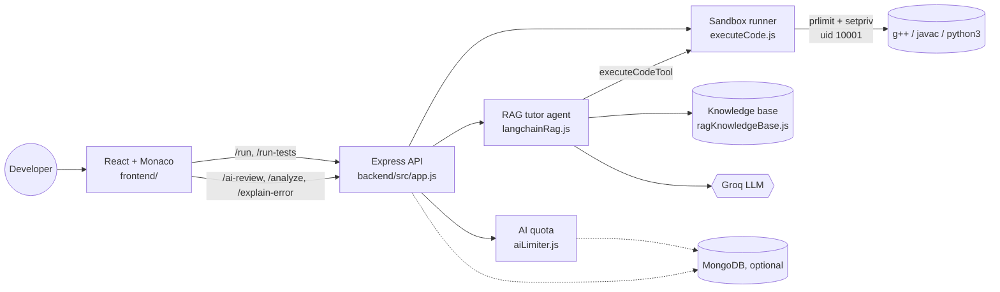

<div align="center">
  
  <h1>CodeLumen</h1>
  <p><strong>Run C++, Java, and Python in the browser and learn with an AI mentor that gives hints, not answers.</strong></p>

  <p>
    
    
    
    
    
    
  </p>
</div>

---

## Overview

CodeLumen is a browser IDE for C++, Java, and Python. Code runs on the server in a hardened sandbox, and a built-in AI tutor reads your code, retrieves relevant reference docs, can run your program to check its own claims, and then nudges you toward the fix instead of writing it for you.

## Features

| Feature | What it does |
| :--- | :--- |
| **Sandboxed execution** | C++17, Java 17, and Python 3 run as an unprivileged user with CPU, memory, process, file-size, and output limits. Server secrets are never visible to programs. |
| **Multi-test-case runs** | Compile once, run against up to 20 inputs, and compare with expected output (ignoring trailing whitespace and CRLF). Bulk import supported. |
| **AI tutor with tools** | LangChain agent on Groq that can call `executeCodeTool` (sandboxed, active language only) and `searchDocsTool`, at most 2 tool calls per turn. |
| **Retrieval-grounded answers** | TF-IDF retrieval over a curated knowledge base (STL, Java Collections, Python stdlib, DSA patterns), with sources shown in chat. |
| **Strict mentor guardrails** | Stays on the user's code and language and refuses to dump full solutions. |
| **Complexity analysis** | Big-O time and space estimate for the current code. |
| **Voice mode** | Browser speech-to-text and text-to-speech for hands-free questions. |
| **Monaco editor** | Themes, Ctrl/Cmd+Enter to run, copy and download, and per-language autosave with a reset-to-template button. |
| **Admin dashboard** | `#dashboard`: usage analytics plus per-IP and global AI quotas, behind signed, expiring admin sessions. |

## Architecture



### API

| Method & path | Description |
| :--- | :--- |
| `GET /health` | Status, sandbox mode, and which integrations are configured |
| `POST /run` | `{ language, code, input }` → `{ output, executionTimeMs }` |
| `POST /run-tests` | `{ language, code, testCases: [{ input, expectedOutput }] }` → per-case results |
| `POST /ai-review` | Tutor chat: `{ language, code, messages }` (uses 1 AI credit) |
| `POST /analyze` | Big-O analysis: `{ code }` (uses 1 AI credit) |
| `POST /explain-error` | Error explanation: `{ errorMessage, code?, language? }` (uses 1 AI credit) |
| `GET /ai-limit-status` | The caller's remaining AI credits |
| `POST /api/admin/login` | `{ password }` → signed session token (5 attempts per 15 min) |
| `GET /api/admin/stats`, `/api/admin/ai-limits`, `POST /api/admin/ai-limits/*` | Admin only (`Authorization: Bearer <token>`) |

## Security model

Running strangers' code is the riskiest thing this app does, so the defaults are strict:

- **Privilege drop.** In the Docker image each compile and run goes through `prlimit` → `setpriv`, so it runs as uid `10001` with no supplementary groups and `no_new_privs`. The app directory is not readable by that user, so programs and `#include` tricks cannot read source or `.env`.
- **Clean environment.** Children get an empty environment (`PATH`, `HOME`, `LANG` only), so API keys never reach user programs.
- **Resource limits.** Wall-clock timeouts (5s run, 15s compile) kill the whole process group. Address-space, CPU-time, process-count, open-file, and file-size rlimits apply, plus a 256 KB output cap. A semaphore limits concurrent jobs and returns 503 when the queue is full.
- **Fail closed.** In production the server refuses to start without the sandbox, unless you set `ALLOW_UNSAFE_EXECUTION=true`.
- **Abuse controls.** The client IP comes from `trust proxy` (not a raw `X-Forwarded-For`), so quotas can't be reset by spoofing headers. AI credits are reserved atomically and refunded on failure. Every AI endpoint is metered. Execution and login have their own rate limits, and request bodies are capped.
- **Admin auth.** Admin is disabled unless `ADMIN_PASSWORD` is at least 12 characters and not a common default. Passwords are compared in constant time, and the browser stores only an HMAC-signed, expiring token.
- **Frontend.** AI replies are rendered as React text, never as HTML. There's a strict CORS allow-list and Helmet headers.

> **Network isolation is not included.** The in-container sandbox does not block outbound network access from submitted programs. For a public deployment, add an egress rule for uid 10001 (for example `iptables -A OUTPUT -m owner --uid-owner 10001 -j REJECT` on a host where you control networking), or run on a platform with per-container egress policies.

## Local development

**Prerequisites:** Node.js 22+, plus `g++` and Python 3 (and a JDK for Java) on your PATH.

```bash
# Backend
cd backend
cp .env.example .env      # add GROQ_API_KEY, optionally MONGODB_URI and ADMIN_PASSWORD
npm install
npm run dev               # http://localhost:8000
```

```bash
# Frontend (new terminal)
cd frontend
npm install
npm run dev               # http://localhost:5173
```

Outside Docker the backend runs in **development mode without isolation** and prints a warning. That's fine on your own machine, but never expose it publicly.

### Run the sandboxed backend with Docker

```bash
docker compose up --build
```

`docker-compose.yml` drops all capabilities except the few needed for the privilege drop, sets `no-new-privileges`, and caps PIDs, memory, and CPU.

### Tests

```bash
cd backend && npm test             # unit + API tests (Node test runner)
cd frontend && npm run lint && npm run build
bash scripts/sandbox-smoke.sh      # against a running Docker container
```

CI (`.github/workflows/ci.yml`) runs the backend tests (with a JDK), lints and builds the frontend, then builds the Docker image and runs the sandbox smoke test. The smoke test checks the uid, secret leakage, source readability, fork-bomb survival, and Java.

## Deployment

- **Frontend:** Vercel or Netlify. Set `VITE_API_URL` to your backend URL.
- **Backend:** any host that runs the Docker image (Render, Railway, Fly.io, a VPS). Set `NODE_ENV=production`, `GROQ_API_KEY`, `CORS_ORIGINS` (your frontend URL), `TRUST_PROXY` (number of proxies in front, usually `1`), and optionally `MONGODB_URI`, `ADMIN_PASSWORD`, and `ADMIN_SESSION_SECRET`.
- `.github/workflows/cd.yml` publishes the backend image to GitHub Container Registry on every push to `main`.

## Credits

CodeLumen is derived from [CompileVerse](https://github.com/Varni1512/CompileVerse) by Varnikumar Patel, rebuilt with a hardened sandbox, quota and auth fixes, tests, and CI. Released under the [MIT License](LICENSE).
